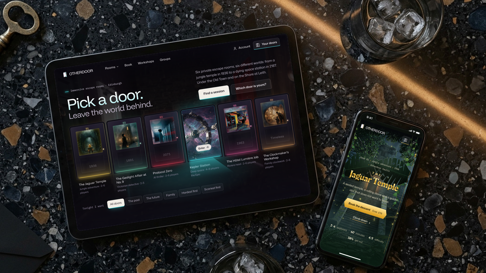
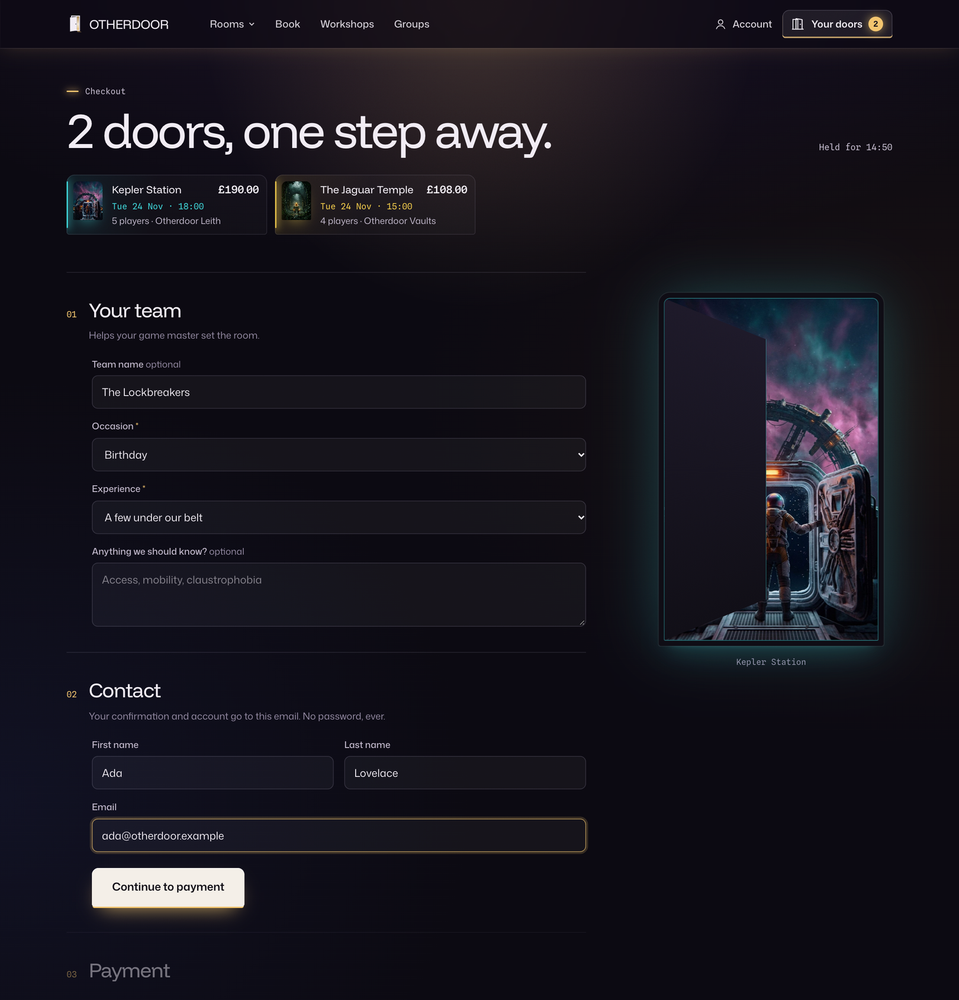
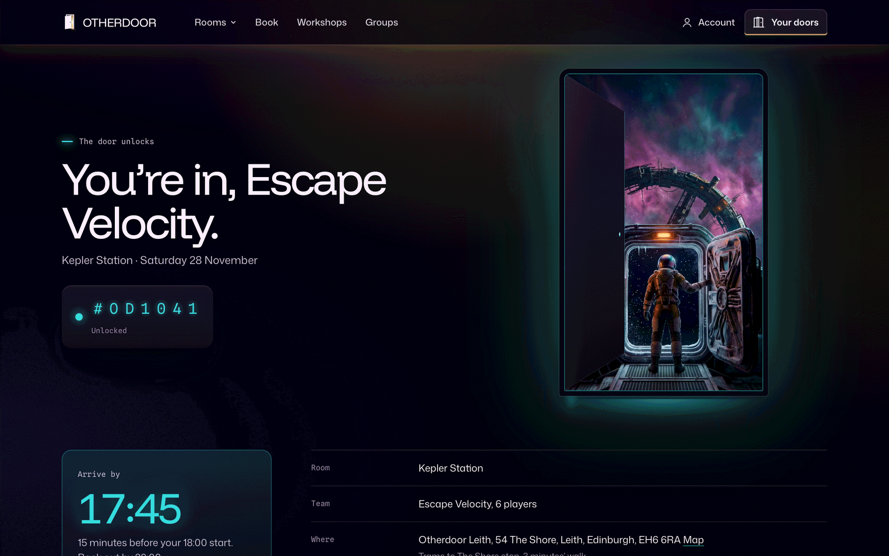
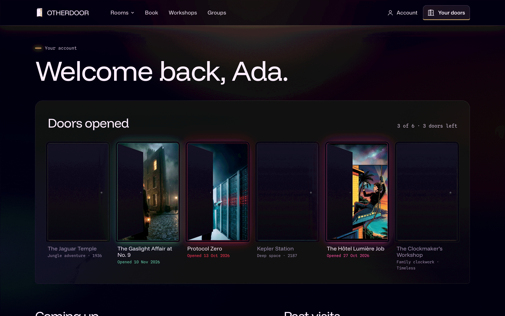

# Afterglow — Next.js Content Gym Template

A production-ready booking website for a boutique gym where the crew shoots you while you train. Built with **Next.js 15**, **Tailwind CSS v4** and the **Opencals Storefront SDK**.

**[View Live Demo →](https://template-afterglow.vercel.app)**



Deco cream, golden-hour gradients, camera viewfinders and grease pencil. Afterglow is a content gym in **Miami** (USD, `America/New_York`): South Beach on Collins Ave with a rooftop and Mirror Hall, and Wynwood with the Neon Room, the Ring and the Studio Wall. The promise is **"You train. We shoot."**: every class can come with the in-house crew, and the edits land in your inbox. It has a full storefront:

- **story rings** on the home page that open full-screen vertical stories;
- a **schedule grouped by set**, with golden-hour badges from the real Miami sunset;
- **shot add-ons** on every class, picked as viewfinder frames and circled in grease pencil;
- **shoots** with the crew, **physique coaching** at 30, 60 or 90 minutes, **glow** (saunas, plunge, red light, glam) and **bar tables**;
- a **contact-sheet** cart, a **release-form** checkout, a **call-sheet** confirmation with a downloadable story card, and **Your roll** in the account.

MIT licensed: clone it, rebrand it, ship it.

---

## Get Started in 3 Steps

### 1. Create an Opencals account

Sign up at **[app.opencals.com](https://app.opencals.com)** and create a **Dev Store** in the **United States** (so prices are in USD). When it asks for a dataset, choose the **Content Gym** preset (seed dataset `content_gym`). It seeds your store with:

- the two sites, ten coaches and six crew (photographers, filmmakers and a makeup artist);
- the weekly timetable, with one variant per class × site × coach;
- physique coaching in three tiers, partner training, six content sessions and the Studio Wall;
- infrared suites, the cold plunge, the red light pod, the compression lounge, glam touch-ups and the free First Glow Tour;
- bar tables, three dated events, the shot add-ons and the bar menu;
- the checkout questions (waiver, content consent, Instagram handle, goal);
- the discounts (First glow, Shot on us, Early light and `GLOW15`);
- sample bookings, so some classes are already full.

### 2. Get your API key

In the Opencals dashboard, go to **User Account Settings** and generate a **private storefront key** (`spk_`). The template calls the API from its server, so the key stays secret, and it forwards each visitor's IP (`nextBuyerIp` in `lib/opencals.ts`) so visitors get their own rate limits. A public key (`sfk_`) also works, but then all visitors share your server's limits.

### 3. Deploy to Vercel

[](https://vercel.com/new/clone?repository-url=https%3A%2F%2Fgithub.com%2Fletsopencals%2Ftemplate-afterglow&env=OPENCALS_API_KEY,AUTH_SECRET&envDescription=API%20key%20from%20your%20Opencals%20dashboard%20and%20a%20random%20secret%20for%20auth&project-name=afterglow&repository-name=template-afterglow)

| Variable | Value |
|----------|-------|
| `OPENCALS_API_KEY` | Your private storefront key (starts with `spk_`) |
| `AUTH_SECRET` | Any random string, used for session encryption |
| `NEXT_PUBLIC_SITE_URL` | *(optional)* Your domain, for the sitemap, canonical URLs and Open Graph |

That's it. Card payments use the Stripe account connected to your store; the key comes from the checkout API, so there's no Stripe variable to set.

---

## What's Included

### Home and the stories

A full-bleed hero video inside a camera viewfinder ("You train. We shoot."), with the next call time burned into the frame. Under it, a row of **story rings** (Neon Room, Rooftop, the Ring, Mirror Hall, the Bar, the sunrise run) opens a **full-screen story viewer**: vertical clips, segmented progress bars, tap left or right, hold to pause, and a "Book" sticker that links into booking. Then: how the crew works, the next call times, the sets as a contact sheet, shoots, the cast and crew, the bar and café, the Glow Pass preview and both sites.


### The schedule (`/schedule`)

One day at a time. The day strip shows each date's session count and **that day's sunset**. Sessions are grouped by **set** (Neon Room, Mirror Hall, the Rooftop, the Ring, the Mural Floor, the beach), each under its photo. A row shows the time, the class, the coach, spots left and a **golden-hour badge** when an outdoor class overlaps the real Miami sunrise or sunset hour (`lib/sun.ts`, the NOAA solar calculation, with tests). Full classes are struck through and point to the next one with space.

Tapping a row **expands it in place**: what the class is, what the crew shoots, the four **shot add-ons as viewfinder frames** you circle (Class Clips, Photo Set, Slow-mo Reel, Raw Camera Roll), bar extras, the price and **Book**. On phones the Book bar sticks to the bottom of the screen while the row is open. Filters cover the site, the class type, the coach and "golden hour only", and everything lives in the URL: `/schedule?s=<series>@<start>` opens a row directly.


### The service booker (`/shoots`, `/coaching`, `/glow`, `/bar`)

Shoots with the crew, physique coaching, recovery and glam, and bar tables all book the same way:

1. Pick the session from the portrait frames.
2. Pick the option (coach tier, suite, site), **who** (portraits with their handles, or anyone free), the site, the length (30/60/90 for coaching, up to 4 hours for the Studio Wall) or the party size for a table.
3. Pick a day and a plain time under it. Golden-hour starts are marked on the rooftop set.

Beside it, a **draft call sheet** fills in as you choose (call time, set, who, length, what you get) and holds **Add to shot list**. On phones the total and the action are pinned to the bottom. Free windows load once per variant, person and site, and every day and start time is worked out in the browser.


### The shot list, the release form, the call sheet

- The cart is a **contact sheet**: each session is a numbered frame with its set photo, and its shot add-ons are circled in grease pencil. Totals and offers always come from the cart.
- **Checkout is a release form**: the shot list runs across the top as a film strip. One document holds *The talent* (your details) and *The release* (the waiver, whether the crew may post you, your Instagram handle, your goal), signed with one "Sign & continue". Then the payment section opens: Stripe or pay at the desk. The free First Glow Tour needs no payment.
- The confirmation is a **call sheet**: call time (15 minutes early, 25 with a shoot), scene, crew, set, wardrobe notes and the circled shots for each session; notes on what to bring, getting there and when the edits land; calendar links; "same time next week"; and a **9:16 story card** drawn on a canvas that you can download and post.
- **`/account`** is **Your roll**: up next as call sheets (move and cancel up to 12 hours before), and every past session on a **contact sheet**, circled when the crew shot it, with an honest delivery state ("in the edit" until the turnaround passes, then "sent to your email"). The edits themselves arrive by email; the site never holds the media. Orders and settings sit alongside it.









### Offers

Offers on a session don't stack: it gets the biggest one (40% off a first class, 20% Early light before 8 AM on weekdays, or `GLOW15`). **Shot on us** is separate: an automatic, combinable discount that takes 30% off shot add-ons, so it applies on top. A code that's beaten by a better offer shows as "a better offer already applies".

### Crew, classes, sites, the Glow Pass

- **`/crew`**: the crew and the coaches, with handles, bios and a book link for each.
- **`/classes/[slug]`**: the class, what the crew shoots, the wardrobe note, the coaches and the next call times.
- **`/sites/[slug]`**: address, hours, transit, parking, facilities and the sets in that building.
- **`/glow-pass`**: a clearly labelled **"Coming soon"** preview of a monthly pass. Nothing is for sale; the call to action is the free First Glow Tour.


<p>
  
  
</p>

### Passwordless accounts

Customers sign in with a 6-digit email code or a magic link (`/link/[token]`). Set **Storefront Base URL** in the Opencals dashboard (Settings → API) to your deployed URL, so emailed links come back here.

### SEO

Per-page metadata, Open Graph, `ExerciseGym` + `HealthClub` structured data per site, robots.txt and sitemap.xml.

---

## The Content Gym Model

Afterglow only uses existing Opencals features. The pattern:

- **Class types are collections** (ride, sculpt, flow, box, sweat), and each has a colour in `lib/site-config.ts`. **Sets** (rooms) aren't API entities: site copy maps each class to its set.
- **One product group per class, one variant per class × site × coach.** `glute-lab-south-beach-valentina` is Glute Lab in South Beach with Valentina. Each variant has its own weekly schedule, one location and one staff member, and `maxAttendees` = spots.
- **Full classes.** The availability API drops a slot once it's full. Classes repeat weekly, so the template learns each series' pattern and shows a missing week as **Full** (`lib/timetable.ts`, with tests).
- **Shots are add-ons** on every class and coaching product. Site copy knows them by title and adds what you get and when (`siteConfig.shots`).
- **The crew are staff** on the content products, so the Staff rule stops a photographer being booked twice. The Studio Wall and Creator Brand Day share a product pool, because they use the same wall.
- **Physique coaching** is one product per tier with a 30-minute base and `allowCustomDuration` up to 90. Partner training and duo shoots are one booking for two, sent as the custom attribute `people = "2"`.
- **Glow suites and bar tables** have no staff and use the Self rule. A table is booked for a party: the party size is the number of attendees.

---

## Tech Stack

| Category | Technology |
|----------|-----------|
| Framework | Next.js 15 (App Router) |
| Styling | Tailwind CSS v4 |
| Fonts | next/font: Syne, Outfit, Fragment Mono |
| Motion | CSS only (shutter flash, story progress, REC blink, light drift, grease pop) |
| Data | SWR (client) + React Server Components |
| Payments | Stripe Elements |
| Auth | NextAuth.js v5 |
| Tests | Vitest |
| API | Opencals Storefront SDK |

---

## Local Development

```bash
git clone https://github.com/letsopencals/template-afterglow.git
cd template-afterglow
npm install
cp .env.example .env.local   # set OPENCALS_API_KEY and AUTH_SECRET
npm run dev
```

Checks: `npm run typecheck`, `npm run lint` and `npm test`. The tests cover the timetable and Full inference across both DST switches, golden hour, the sunrise and sunset calculation, the catalog, the booker's start times and the roll. `/preview/call-sheet` and `/preview/roll` show the post-booking screens with sample data in development.

---

## Customization

- **`lib/site-config.ts`** holds everything the API has no field for:
  - the name, contact details, the promise and site copy;
  - category colours, the sets, which class runs on which set, wardrobe notes and what the crew shoots;
  - service copy and lengths, crew roles and handles, the shot add-on deliverables;
  - the stories, and the Glow Pass preview.
- **The store holds the bookable data**: classes, prices, capacities, coaches and crew, sites, availability, add-ons, questions and discounts.
- **Theme**: the tokens are in `app/globals.css`, and the design contract is in **`DESIGN.md`**.
- **Imagery**: class photos, portraits and the logo come from your store. Set photos, stories, gallery photos and the hero video live in `public/` (paths in `siteConfig`). A missing file falls back to the gradient placeholder.

---

## Other templates

| Template | Industry | Demo |
|---|---|---|
| [HAAR](https://github.com/letsopencals/template-haar) | Hair salon | [template-haar.vercel.app](https://template-haar.vercel.app) |
| [Frisør](https://github.com/letsopencals/template-frisor) | Barbershop | [template-frisor-sage.vercel.app](https://template-frisor-sage.vercel.app) |
| [Clear Care](https://github.com/letsopencals/template-clarity) | Medical clinic | [template-clarity.vercel.app](https://template-clarity.vercel.app) |
| [VOLT](https://github.com/letsopencals/template-volt) | Padel & squash clubs | [template-volt.vercel.app](https://template-volt.vercel.app) |
| [NOIR Drive](https://github.com/letsopencals/template-noir) | Car rental | [template-noir.vercel.app](https://template-noir.vercel.app) |
| [Fluently](https://github.com/letsopencals/template-fluently) | Language school | [template-fluently.vercel.app](https://template-fluently.vercel.app) |
| [Bali Villa Rentals](https://github.com/letsopencals/template-bali-villas) | Villa rentals | [template-bali-villas.vercel.app](https://template-bali-villas.vercel.app) |
| [Tensile](https://github.com/letsopencals/template-reformer) | Reformer Pilates | [template-reformer.vercel.app](https://template-reformer.vercel.app) |
| [Alba Dental](https://github.com/letsopencals/template-alba) | Dental clinic | [template-alba.vercel.app](https://template-alba.vercel.app) |
| [Gable](https://github.com/letsopencals/template-gable) | Coworking | [template-gable.vercel.app](https://template-gable.vercel.app) |
| [METTLE](https://github.com/letsopencals/template-mettle) | Boutique gym | [template-mettle.vercel.app](https://template-mettle.vercel.app) |

---

## License

MIT
