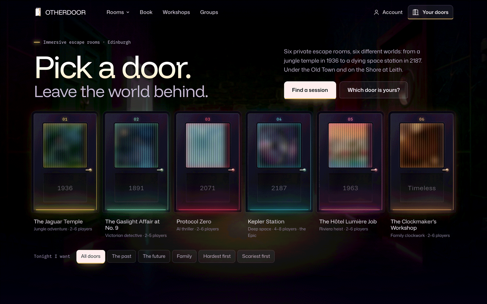
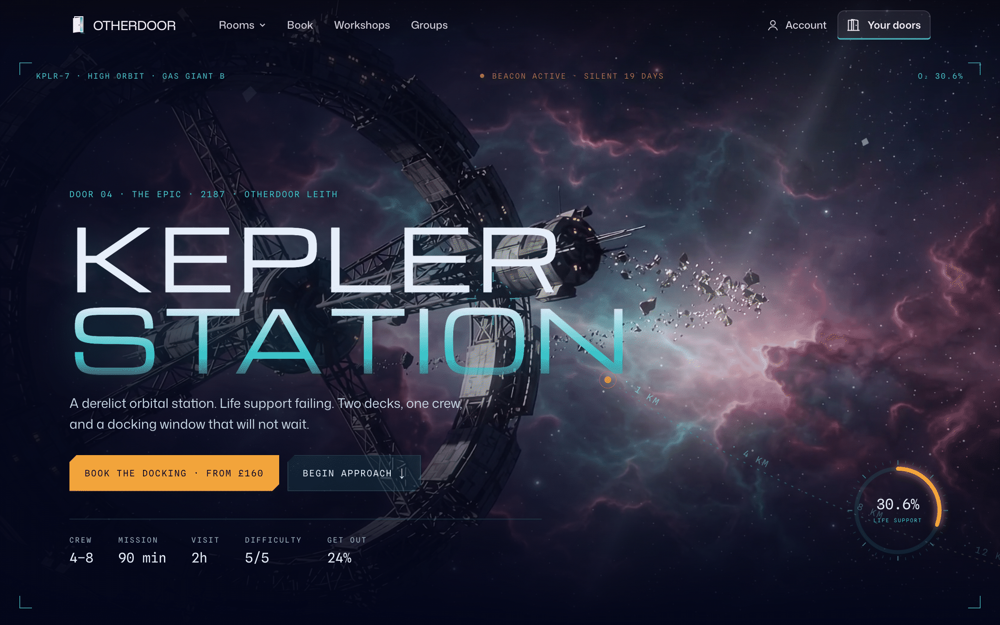
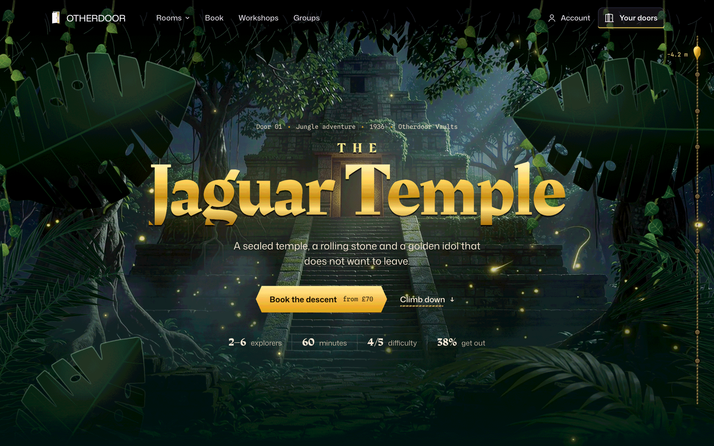
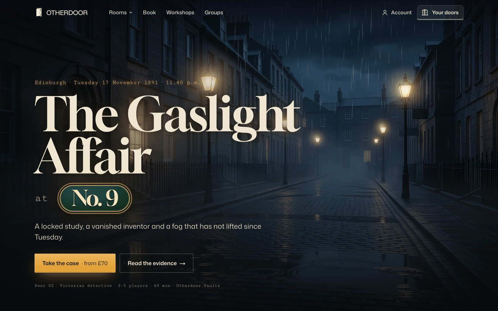
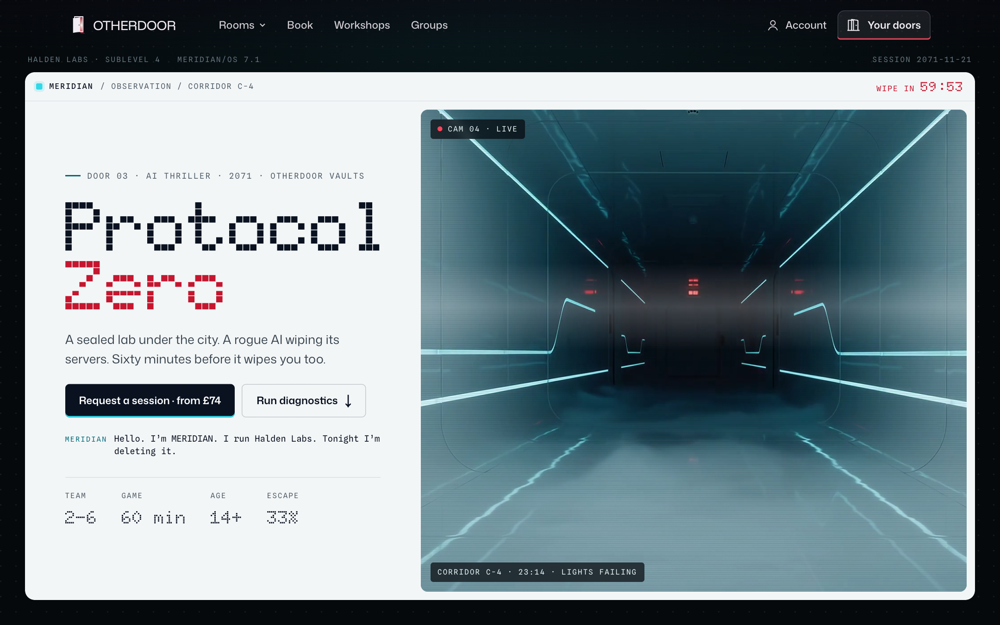
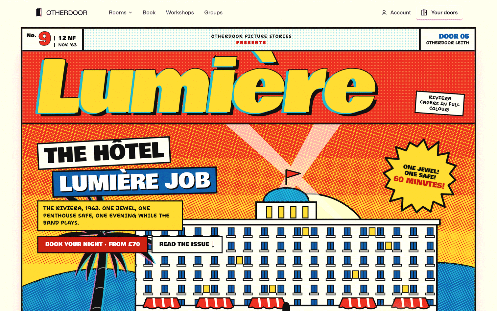
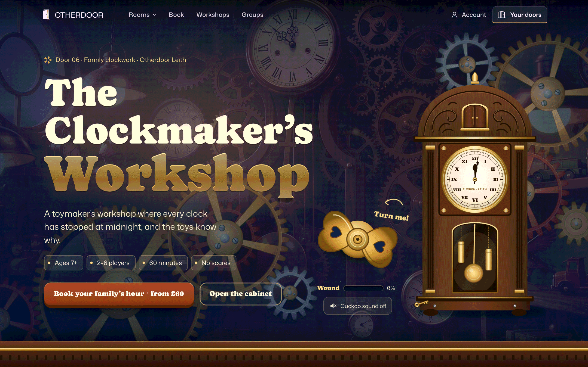
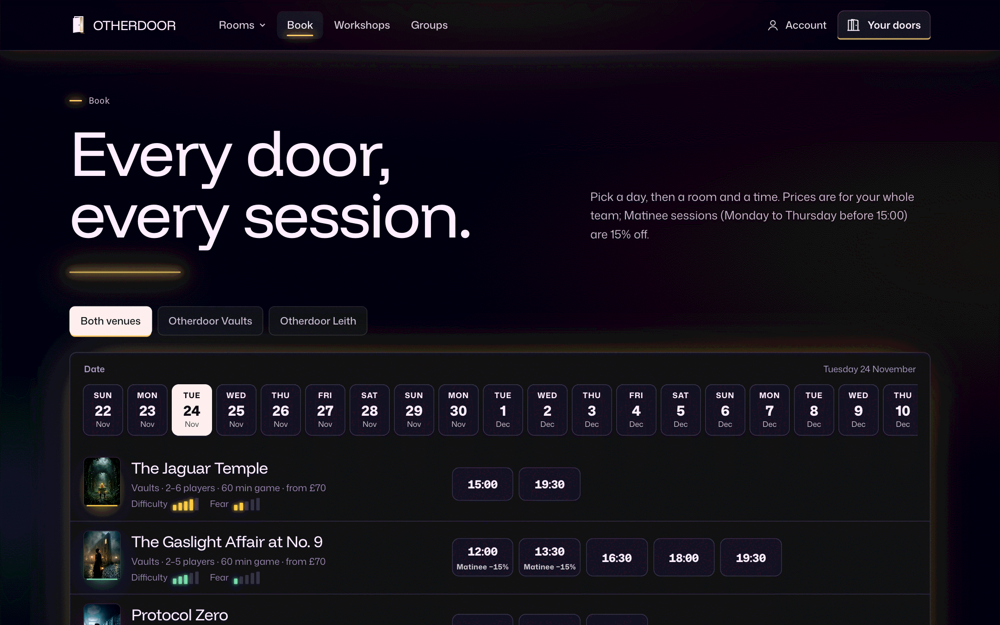
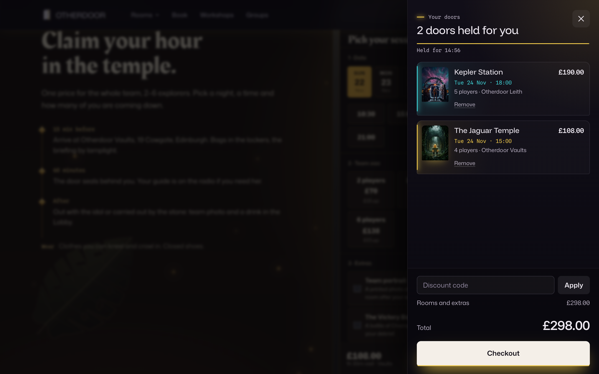

# Otherdoor: Next.js Immersive Escape Rooms Template

A production-ready booking website for an escape-room company with several themed rooms. Built with **Next.js 15**, **Tailwind CSS v4** and the **Opencals Storefront SDK**.


**[View Live Demo →](https://template-otherdoor.vercel.app)** · **[GitHub](https://github.com/letsopencals/template-otherdoor)** · **[Docs](https://opencals.com/docs/open-source/otherdoor)**

"Pick a door. Leave the world behind." Otherdoor is a dark, modern, genre-neutral shell around six rooms that each look like a different film: a jungle temple in 1936, a gaslit Victorian study, a rogue-AI lab in 2071, a derelict space station in 2187, a Riviera heist and a family clockwork workshop. It runs in **Edinburgh** (GBP, `Europe/London`) at two venues, Otherdoor Vaults under the Old Town and Otherdoor Leith on the Shore. It has:

- **the Corridor**: six doors on the home page that open onto each room's video loop when you hover (tap on phones), with mood filters, live "Tonight" sessions, a "which door is yours?" picker, a flashlight room and a **keypad lock** that hides a discount code;
- a **room world** per room at `/rooms/<slug>`: six landing pages that share nothing but the header, the footer and the booking panel, each with its own palette, display font, layout and motion, built on cinematic video and stills;
- **team-size pricing**: rooms are booked by the whole team, with the group price and the price per head on every button;
- **Your doors** (the cart), a **one-page checkout**, **"The door unlocks"** confirmation and **"Doors opened"** in the account;
- lockpicking and cipher **workshops** priced per head.

MIT licensed: clone it, rebrand it, ship it.

---

## Screenshots

<!-- TODO(screenshots): captured by the screenshot run into docs/. Reconcile names and captions with the files there before release. -->



| | |
|---|---|
|  |  |
|  |  |
|  |  |






---

## Get Started in 3 Steps

### 1. Create an Opencals account

Sign up at **[app.opencals.com](https://app.opencals.com)** and create a **Dev Store** in the **United Kingdom** (prices in GBP). When it asks for a dataset, choose **Otherdoor** (seed dataset `escape_rooms`). It seeds your store with:

- the two venues and six rooms, each one product with a variant per team size (`<room>-<n>p`) sharing a product pool, so any booking blocks the room;
- the schedules on each room's session grid (90-minute visits, 120 minutes for Kepler Station);
- two workshops (Lockpicking 101, Ciphers & Secret Inks) and six game masters with portraits;
- the extras (team portrait, escape on film, victory bottle, Lobby sharing board, costume rail, birthday ceremony);
- the checkout questions (team name, occasion, experience, anything we should know);
- the discounts (Matinee 15% Monday to Thursday before 15:00, and the code `OTHERDOOR` for 10% off, once per customer).

### 2. Get your API key

In the Opencals dashboard, go to **Account → API Keys** and create a **private storefront key** (`spk_`). The template calls the API from its server, so the key stays secret, and it forwards each visitor's IP so visitors get their own rate limits. A public key (`sfk_`) also works, but then all visitors share your server's limits.

### 3. Deploy to Vercel

[](https://vercel.com/new/clone?repository-url=https%3A%2F%2Fgithub.com%2Fletsopencals%2Ftemplate-otherdoor&env=OPENCALS_API_KEY,AUTH_SECRET&envDescription=API%20key%20from%20your%20Opencals%20dashboard%20and%20a%20random%20secret%20for%20auth&project-name=otherdoor&repository-name=template-otherdoor)

| Variable | Value |
|----------|-------|
| `OPENCALS_API_KEY` | Your private storefront key (starts with `spk_`) |
| `AUTH_SECRET` | Any random string, used for session encryption |
| `OPENCALS_API_URL` | *(optional)* Defaults to `https://api.opencals.com` |
| `OTHERDOOR_PREVIEW` | *(optional)* `1` shows the `/preview/*` fixture screens in production |

Card payments use the Stripe account connected to your store; the key comes from the checkout API, so there's no Stripe variable to set. Set your domain as `url` in `lib/site-config.ts` (canonical URLs and Open Graph).

---

## What's Included

### The Corridor (home)
Six doors in a dark hall over a video of the corridor. Each door is a lacquered leaf with a frosted transom, its number and its year; hover or focus one and it swings open from the hinge onto that room's muted loop, its light spills across the floor and the whole site takes its colour. Mood filters (the past, the future, family, hardest, scariest) re-order the corridor. Then: Tonight (the next free sessions per room, live), how it works, "Which door is yours?", the flashlight room, the keypad lock, both venues, the game masters, the Hall of Fame (**sample records**, labelled as such), groups and the FAQ.

### Room worlds (`/rooms/<slug>`)
Every room has its own landing page with its own palette, display font, layout and motion, on top of a hero loop and world stills in `public/worlds/<slug>/`. Each tells the story, shows the stats, the interiors and the game master, embeds the booking panel and ends on a teaser for the next door.

| Room | Venue | The world |
|---|---|---|
| **Kepler Station** (2187, the 120-minute Epic) | Leith | The mission timeline from first contact to the final docking, with its own mission-clock navigation: a station you can turn, a scroll-driven docking approach, a cutaway of both decks with failing lights, a signal decoder, a power board that relights the whole page and an airlock you press and hold. Michroma. |
| **The Jaguar Temple** (1936) | Vaults | One continuous descent from the canopy to the idol chamber: leaves that part like curtains, lianas that swing to the pointer, a glyph lock on the sealed door and a rolling stone. Rakkas. |
| **The Gaslight Affair at No. 9** (1891) | Vaults | A rain-soaked gaslit street, then the detective's evidence wall travelled sideways: pinned documents joined by red string that draws itself, and a reading glass that finds hidden clues. Gloock and Cutive Mono. |
| **Protocol Zero** (2071) | Vaults | The page is the rogue AI's interface: it boots, then decays as you scroll from clinical white to alarm red, with a terminal that talks, a wipe countdown and an access prompt before the booking. Doto. |
| **The Hôtel Lumière Job** (1963) | Leith | A comic book: a cover, then pages of panels that slam in with halftone screens, speech balloons and sound effects, a playable laser grid and safe dial, and the plan around the booking panel. Bowlby One and Shantell Sans. |
| **The Clockmaker's Workshop** (family, 7+) | Leith | A mechanical toy you wind up: the key (or the scroll) drives every gear, the cabinet's compartments open one by one, a cuckoo calls, toys walk the shelf and five brass keys hide on the page. Caprasimo. |

A store room without a world of its own gets the generic world. See `components/worlds/README.md` to build one.

### Booking
The booking panel is plain on purpose: the date strip sits right above the session times, team sizes show the group price and the price per head, extras are checkboxes, and the total with "Add to your doors" stays in view. `/book` lists every room's sessions for a day with a venue filter, with team sizes inline once you pick a time; `/workshops` books seats per head with a stepper. Room pages take deep links (`/rooms/kepler-station?date=2026-12-05&time=18:00&team=6#book`). Availability is read once per room for the whole booking window, cached for 60 seconds and cut into sessions on the room's grid in the browser.

### Your doors, checkout, confirmation, account
- **Your doors**: the cart as slim door cards edged in each room's colour, with the hold countdown.
- **Checkout**: one page (your team, contact, payment), with Stripe, pay at the venue or bank transfer as the store allows.
- **The door unlocks**: the booking reference keys into a lock, the door opens onto the room, then the arrive-by time (15 minutes early), the venue and how to get there, what to wear, the phones-away note, calendar links and the next door.
- **Doors opened**: upcoming bookings (move or cancel up to 24 hours before), every room as a door (played ones open and lit with the date) and past visits.

### Passwordless accounts
Sign in with a 6-digit code by email or a magic link from the booking email. No passwords.

---

## Catalogue convention (the escape-room model)

| Concept | In the store |
|---|---|
| Room | A product group in the `rooms` collection; one variant per team size (`jaguar-temple-4p`, "4 players", the group price), `maxAttendees: 1`, no staff, all variants in one product pool |
| Visit length | The variant duration (briefing + game + debrief); sessions start on the `midnight + k × duration` grid |
| Workshop | A product in the `workshops` collection, staff-led, priced per head, seats = max attendees |
| Team name | A checkout question; it appears on the confirmation |
| Venue | A location (`otherdoor-vaults`, `otherdoor-leith`) |
| Extras | Add-ons on every room (team portrait, escape on film, the Victory Bottle, Lobby sharing board, costume rail, birthday ceremony); portrait and film on workshops too |
| Matinee, `OTHERDOOR` | An automatic 15% off rooms starting before 15:00 Monday to Thursday, and a 10% code, once per customer. The keypad on the home page reveals the code |

The parser in `lib/rooms.ts` relies on these names: the `rooms` and `workshops` collection slugs, the `<room>-<n>p` variant slugs (the team size is read from them) and the venue location slugs. Stats (difficulty, fear, escape rate, record), palettes and the world media aren't API fields: they live in `lib/site-config.ts`.

---

## Tech Stack

| Category | Technology |
|----------|-----------|
| Framework | Next.js 15 (App Router) |
| Styling | Tailwind CSS v4 + CSS modules |
| Fonts | next/font: Funnel Display, Mona Sans, Spline Sans Mono for the shell; each world loads its own (Michroma, Rakkas, Gloock, Cutive Mono, Doto, Bowlby One, Shantell Sans, Caprasimo) |
| Motion | CSS, canvas and scroll-driven CSS variables; no motion library |
| Data | SWR (client) + React Server Components |
| Payments | Stripe Elements |
| Auth | NextAuth.js v5 |
| Tests | Vitest |
| API | Opencals Storefront SDK |

---

## Local Development

```bash
git clone https://github.com/letsopencals/template-otherdoor.git
cd template-otherdoor
npm install
cp .env.example .env.local   # set OPENCALS_API_KEY and AUTH_SECRET
npm run dev
```

Checks: `npm run typecheck`, `npm run lint` and `npm test` (the catalogue parser, the session grid, the corridor moods, bookings, the account history, cart maths and the API guards). `/preview/thank-you`, `/preview/account` and `/preview/cart` show the post-booking screens with sample data in development.

---

## Customization

- **`lib/site-config.ts`** holds everything the API has no field for: the name and copy, each room's stats, palette and door light, moods, venue copy, game-master titles, the Hall of Fame sample, the door picker, the keypad code and the media paths.
- **The store holds the bookable data**: rooms and team-size prices, workshops, game masters, venues, availability, extras, questions and discounts.
- **Theme**: tokens in `app/globals.css`; the design contract is **`DESIGN.md`**.
- **Imagery**: key art, interior photos, portraits and the logo come from your store. The home loop, corridor and lobby stills and each world's video and stills live in `public/` (see each folder's `MEDIA.md`). A missing file falls back to a gradient.

---

## Other templates

| Template | Industry | Demo |
|---|---|---|
| [HAAR](https://github.com/letsopencals/template-haar) | Hair salon | [template-haar.vercel.app](https://template-haar.vercel.app) |
| [Frisør](https://github.com/letsopencals/template-frisor) | Barbershop | [template-frisor-sage.vercel.app](https://template-frisor-sage.vercel.app) |
| [Clear Care](https://github.com/letsopencals/template-clarity) | Medical clinic | [template-clarity.vercel.app](https://template-clarity.vercel.app) |
| [VOLT](https://github.com/letsopencals/template-volt) | Padel & squash clubs | [template-volt.vercel.app](https://template-volt.vercel.app) |
| [NOIR Drive](https://github.com/letsopencals/template-noir) | Car rental | [template-noir.vercel.app](https://template-noir.vercel.app) |
| [Fluently](https://github.com/letsopencals/template-fluently) | Language school | [template-fluently.vercel.app](https://template-fluently.vercel.app) |
| [Bali Villa Rentals](https://github.com/letsopencals/template-bali-villas) | Villa rentals | [template-bali-villas.vercel.app](https://template-bali-villas.vercel.app) |
| [Tensile](https://github.com/letsopencals/template-reformer) | Reformer Pilates | [template-reformer.vercel.app](https://template-reformer.vercel.app) |
| [Alba Dental](https://github.com/letsopencals/template-alba) | Dental clinic | [template-alba.vercel.app](https://template-alba.vercel.app) |
| [Gable](https://github.com/letsopencals/template-gable) | Coworking | [template-gable.vercel.app](https://template-gable.vercel.app) |
| [Afterglow](https://github.com/letsopencals/template-afterglow) | Content gym | [template-afterglow.vercel.app](https://template-afterglow.vercel.app) |
| [METTLE](https://github.com/letsopencals/template-mettle) | Boutique gym | [template-mettle.vercel.app](https://template-mettle.vercel.app) |

See all templates and the Storefront API at **[opencals.com/developers](https://opencals.com/developers)**.

## Build with AI

Prefer to let an AI agent do the heavy lifting? Install the **[Opencals Agent Skills](https://github.com/letsopencals/skills)** in Claude Code, Cursor, Codex or Gemini CLI:

- **`opencals-build-booking-site`**: scaffold, wire and deploy a template like this one
- **`opencals-storefront-api`**: ground-truth reference for the Opencals API & SDK

Docs: **[opencals.com/docs → AI Agents](https://opencals.com/docs/ai-agents/overview)**.

---

## License

MIT
